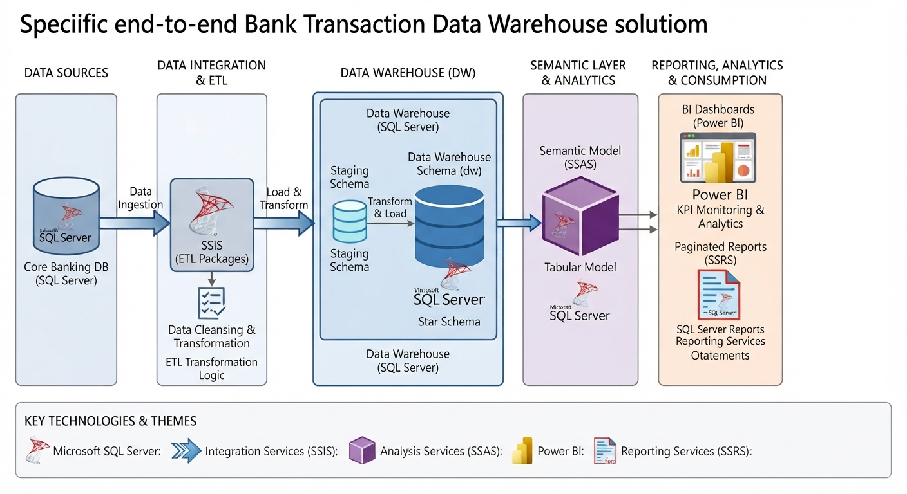
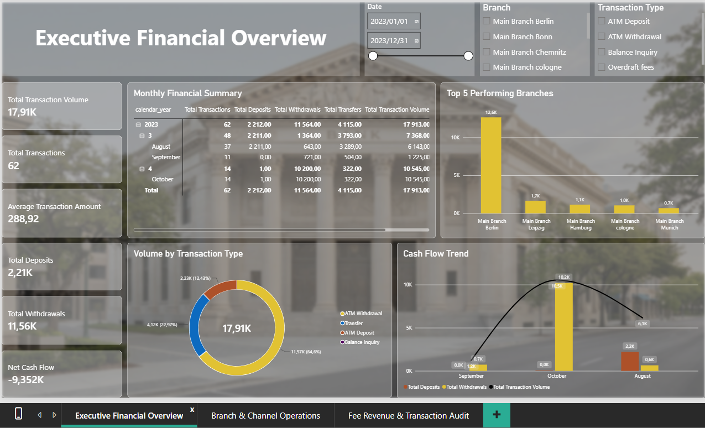
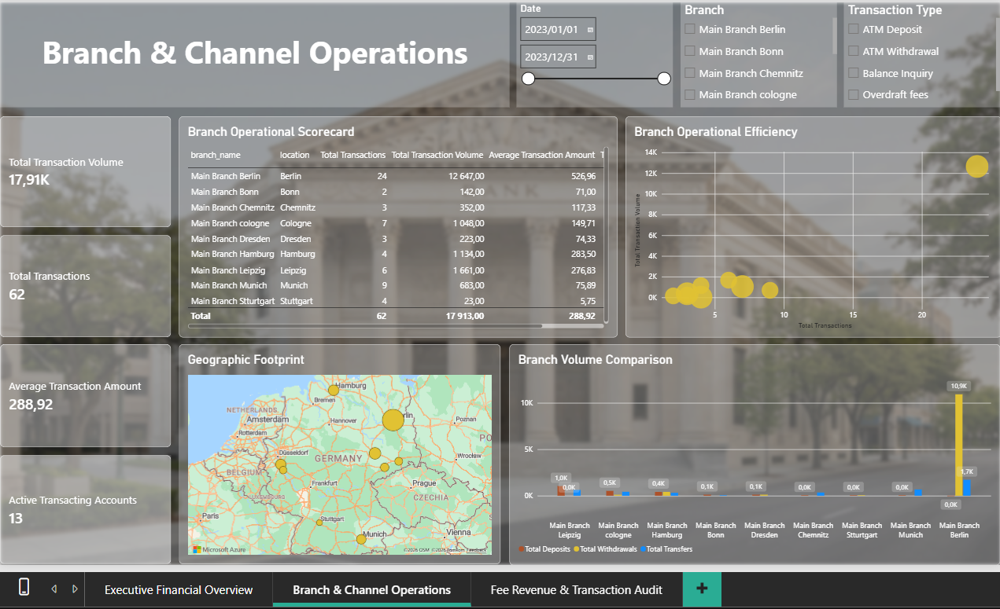

# Bank Transactions Analytics

## Project Overview
An end-to-end banking data and business intelligence solution built with the Microsoft BI suite. It takes raw operational banking data, turns it into structured analytics, models key business metrics, and delivers visual dashboards alongside formal operational reports.

## Problem Statement
Operational banking systems are built for daily transaction processing rather than historical tracking or cross-branch reporting. Without a centralized reporting layer, reviewing branch settlement performance, tracking operational activity, and auditing fee revenue takes manual effort and delays decision-making.

## Objectives
* Centralize banking transaction data into a single reporting foundation.
* Automate data movement and preparation to reduce manual work and improve data reliability.
* Establish consistent business metrics across analytics and reporting tools.
* Provide clear, interactive dashboards for leadership and operational teams.
* Deliver standardized settlement statements to support branch reconciliation.

## Solution Overview
The solution moves data step by step from the core banking transaction system through automated data integration and warehousing into a centralized business metric model. From there, it powers interactive dashboards for visual exploration and structured reports for formal operational statements.

## Executive Financial Summary
Gives leadership a clear snapshot of overall banking activity, transaction volume, fee performance, and trends over time to support strategic planning.

## Branch & Channel Operations
Helps operations teams monitor activity across branches and service channels, making it easier to spot busy periods, regional trends, and service patterns.

## Fee Revenue & Transactions Audit
Supports financial oversight and reconciliation by breaking down transaction counts, volumes, and fee revenue across branches and transaction types, paired with formal monthly settlement statements.

## Tasks & Activities
* **Data Warehousing:** Designed a structured reporting warehouse to organize historical banking data for fast, reliable analysis.
* **ETL Integration:** Built automated data pipelines to extract, clean, and load operational data into the reporting environment.
* **Semantic Modeling:** Created a unified business metric layer so teams see consistent numbers across reports.
* **Interactive Dashboards:** Built visual dashboards for executive tracking, branch and channel operations, and fee auditing.
* **Operational Reporting:** Developed and deployed parameterized settlement statements for ongoing branch review.

## Technology Stack
* **Database & Data Warehouse:** Microsoft SQL Server
* **Data Integration (ETL):** SQL Server Integration Services (SSIS)
* **Semantic Modeling:** SQL Server Analysis Services (SSAS)
* **Business Intelligence & Reporting:** Power BI and SQL Server Reporting Services (SSRS)
* **Development Tools:** SQL Server Management Studio (SSMS) and Visual Studio
